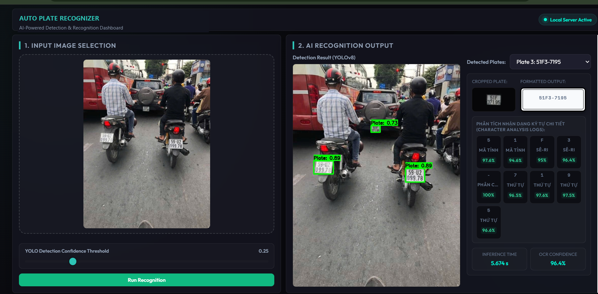
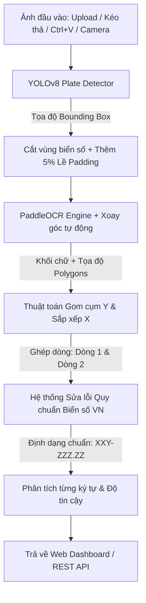

# 🚗 Auto Plate Recognizer (ALPR / ANPR System)

Hệ thống nhận diện biển số xe máy và ô tô Việt Nam tự động, kết hợp mô hình học sâu **YOLOv8** để phát hiện vị trí biển số, **PaddleOCR** để nhận dạng ký tự quang học, cùng thuật toán hậu xử lý hình học & quy chuẩn định dạng biển số xe Việt Nam.



---

## 📌 Mục Lục
- [Giới Thiệu Tổng Quan](#-giới-thiệu-tổng-quan)
- [Chi Tiết Các Mô Hình AI & Thuật Toán](#-chi-tiết-các-mô-hình-ai--thuật-toán)
  - [1. Mô hình Phát hiện Biển số (YOLOv8 Detector)](#1-mô-hình-phát-hiện-biển-số-yolov8-detector)
  - [2. Mô hình Đọc Ký tự Quang học (PaddleOCR Engine)](#2-mô-hình-đọc-ký-tự-quang-học-paddleocr-engine)
  - [3. Thuật toán Phân cụm Không gian & Sắp xếp Dòng (Spatial Sorting)](#3-thuật-toán-phân-cụm-không-gian--sắp-xếp-dòng-spatial-sorting)
  - [4. Bộ lọc Hậu xử lý Quy chuẩn Biển số Việt Nam (Rule-based Corrector)](#4-bộ-lọc-hậu-xử-lý-quy-chuẩn-biển-số-việt-nam-rule-based-corrector)
- [Quy Trình Hoạt Động (Pipeline Workflow)](#-quy-trình-hoạt-động-pipeline-workflow)
- [Tính Năng Nổi Bật](#-tính-năng-nổi-bật)
- [Cấu Trúc Thư Mục Dự Án](#-cấu-trúc-thư-mục-dự-án)
- [Hướng Dẫn Cài Đặt & Sử Dụng](#-hướng-dẫn-cài-đặt--sử-dụng)
  - [Yêu cầu môi trường](#yêu-cầu-môi-trường)
  - [Các bước khởi chạy](#các-bước-khởi-chạy)
- [Tài Liệu API (Inference Endpoint)](#-tài-liệu-api-inference-endpoint)
- [Huấn Luyện Lại Mô Hình (Retraining YOLOv8)](#-huấn-luyện-lại-mô-hình-retraining-yolov8)

---

## 📖 Giới Thiệu Tổng Quan

**Auto Plate Recognizer** là giải pháp toàn diện cho bài toán Nhận dạng Biển số Xe Tự động (Automatic License Plate Recognition - ALPR). Hệ thống được tối ưu hóa đặc thù cho các loại biển số lưu hành tại Việt Nam (biển số trắng xe cá nhân, biển vàng kinh doanh, biển số xe máy 2 dòng, biển ô tô 1 dòng hoặc 2 dòng).

Hệ thống tích hợp sẵn giao diện Web Dashboard trực quan, tương thích đa nền tảng (PC, máy tính bảng, điện thoại di động thông qua mạng cục bộ Wi-Fi).

---

## 🧠 Chi Tiết Các Mô Hình AI & Thuật Toán

Hệ thống hoạt động dựa trên sự phối hợp 2 tầng mô hình học sâu kết hợp thuật toán xử lý ảnh số chuyên sâu:

```
[Ảnh gốc] ──> [YOLOv8 Detection] ──> [Crop Plate + 5% Padding] ──> [PaddleOCR + Orientation Cls] ──> [Phân dòng & Sửa lỗi] ──> [Biển số chuẩn]
```

### 1. Mô hình Phát hiện Biển số (YOLOv8 Detector)
- **Kiến trúc:** YOLOv8 (phiên bản `yolov8n` - Nano của Ultralytics).
- **Trọng số:** Được lưu trữ tại [`weights/best.pt`](file:///d:/auto-plate-recognizer/weights/best.pt) (kích thước siêu nhẹ ~6.2 MB, tốc độ suy luận 10 - 25ms trên GPU hoặc 40 - 80ms trên CPU tiêu chuẩn).
- **Cơ chế hoạt động:**
  - Mô hình tiếp nhận ảnh đầu vào ở mọi tỷ lệ kích thước.
  - Sử dụng mạng nơ-ron tích chập không neo (Anchor-free split head) giúp phát hiện chính xác tọa độ hộp bao (Bounding Box: $x_1, y_1, x_2, y_2$) và độ tin cậy (`confidence score`) của từng biển số trong khung hình.
  - **Tự động mở rộng biên (Margin Padding):** Khi phát hiện biển số, thuật toán tự động lấy thêm 5% lề xung quanh nhằm đảm bảo không bị cắt lẹm viền ký tự khi ảnh chụp góc nghiêng hoặc biển số sát mép.

### 2. Mô hình Đọc Ký tự Quang học (PaddleOCR Engine)
- **Kiến trúc:** PP-OCR (PaddleOCR Framework).
- **Bộ nhận diện ký tự:** Sử dụng mô hình nhận dạng ngôn ngữ tiếng Anh/ký tự la-tinh (`lang='en'`), tối ưu hóa độ chính xác cao nhất cho chữ cái viết hoa `[A-Z]` và chữ số `[0-9]`.
- **Bộ phân loại hướng văn bản (Text Angle / Orientation Classifier):** Kích hoạt `use_textline_orientation=True` giúp tự động xoay và cân chỉnh dòng chữ nếu biển số xe bị nghiêng hoặc chụp lệch góc.

### 3. Thuật toán Phân cụm Không gian & Sắp xếp Dòng (Spatial Sorting)
Biển số xe Việt Nam thường gồm 2 dạng: **Biển 1 dòng** (ô tô) và **Biển 2 dòng** (xe máy hoặc biển vuông ô tô). Do OCR trả về các cụm từ độc lập, hệ thống áp dụng giải thuật hình học:
- **Phân hàng (Row Grouping):** Tính toán tọa độ tâm theo trục $Y$ (`cy`) và chiều cao trung bình (`height`) của từng khối văn bản. Nếu khoảng cách $\Delta Y < 0.6 \times \text{height}$, các khối chữ được gộp chung một hàng.
- **Sắp xếp theo thứ tự đọc (Left-to-Right Sorting):** Trong cùng một hàng, các ký tự được sắp xếp tăng dần theo tọa độ tâm trục $X$ (`cx`).

### 4. Bộ lọc Hậu xử lý Quy chuẩn Biển số Việt Nam (Rule-based Corrector)
Do điều kiện bụi bẩn, ốc vít bắt biển số hoặc phản xạ ánh sáng, OCR có thể nhầm lẫn giữa chữ cái và số tương đồng. Module [`src/ocr.py`](file:///d:/auto-plate-recognizer/src/ocr.py) áp dụng quy luật cấu trúc biển số Việt Nam để tự động sửa lỗi:
1. **Quy tắc 2 ký tự đầu (Mã tỉnh/thành phố):** Luôn là 2 chữ số (ví dụ: `29`, `30`, `51`,...). Nếu OCR nhận diện nhầm thành chữ, hệ thống tự động ánh xạ:
   - `O, D, Q` $\rightarrow$ `0`
   - `I, L` $\rightarrow$ `1`
   - `Z` $\rightarrow$ `2`
   - `A` $\rightarrow$ `4`
   - `S` $\rightarrow$ `5`
   - `G` $\rightarrow$ `6`
   - `B` $\rightarrow$ `8`
2. **Quy tắc sê-ri đăng ký:** Bao gồm 1-2 chữ cái (hoặc kèm 1 số đối với xe máy), nằm ngay sau mã tỉnh.
3. **Quy tắc dãy số thứ tự:** Các ký tự cuối cùng luôn là chuỗi số (từ 3 đến 5 chữ số). Hệ thống quét ngược từ cuối chuỗi để nắn các chữ bị nhầm thành số tương ứng.
4. **Định dạng hiển thị chuẩn:** Tự động chèn dấu gạch ngang và dấu chấm:
   - Ví dụ: `51G10096` $\rightarrow$ `51G-100.96`
   - Ví dụ: `29A1234` $\rightarrow$ `29A-1234`

---

## ⚙️ Quy Trình Hoạt Động (Pipeline Workflow)



---

## ✨ Tính Năng Nổi Bật

- ⚡ **Tốc độ xử lý tức thì:** Pipeline hoàn tất nhận diện chỉ trong vài chục mili-giây.
- 🎯 **Độ chính xác vượt trội:** Tự động xử lý biển 1 hàng và 2 hàng, khắc phục các trường hợp biển số cong vênh hoặc nghiêng góc.
- 📋 **Trực quan hóa chi tiết:** Phân tách từng ký tự trong biển số, gán nhãn chức năng (*Mã tỉnh, Sê-ri, Thứ tự, Dấu phân cách*) cùng điểm tin cậy riêng biệt.
- 💻 **Thao tác nhanh chóng:**
  - Kéo thả file ảnh trực tiếp vào giao diện.
  - Dán trực tiếp từ bộ nhớ tạm bằng phím tắt `Ctrl + V`.
  - Mở camera chụp ảnh trực tiếp khi truy cập trên điện thoại thông minh.
- 🌐 **Hỗ trợ truy cập mạng nội bộ (LAN):** Máy chủ tự động phát hiện địa chỉ IP nội bộ, cho phép các thiết bị khác trong cùng Wi-Fi kết nối sử dụng ngay mà không cần cấu hình phức tạp.

---

## 📂 Cấu Trúc Thư Mục Dự Án

```
auto-plate-recognizer/
├── dataset/                   # Dữ liệu phục vụ huấn luyện (train, val, test)
│   └── data.yaml              # Cấu hình đường dẫn và phân lớp dữ liệu YOLO
├── src/                       # Mã nguồn xử lý lõi (Core Engine)
│   ├── detector.py            # Module nhận diện & cắt biển số sử dụng YOLOv8
│   └── ocr.py                 # Module OCR, phân cụm không gian & chuẩn hóa biển số VN
├── static/                    # Tài nguyên tĩnh cho Web Dashboard
│   ├── css/                   # Giao diện CSS hiện đại (Dark theme cao cấp)
│   ├── js/                    # Xử lý sự kiện kéo thả, gọi API, phím tắt Ctrl+V
│   └── demo.png               # Ảnh chụp giao diện minh họa
├── templates/                 # Giao diện HTML
│   └── index.html             # Dashboard chính của hệ thống
├── weights/                   # Thư mục lưu trữ trọng số mô hình
│   └── best.pt                # Trọng số YOLOv8 đã fine-tune cho biển số
├── main.py                    # Khởi chạy Flask Server & API Backend
├── requirements.txt           # Danh sách các thư viện phụ thuộc
├── yolov8n.pt                 # Trọng số gốc YOLOv8 nano (dự phòng)
└── README.md                  # Hướng dẫn chi tiết dự án
```

---

## 🚀 Hướng Dẫn Cài Đặt & Sử Dụng

### Yêu cầu môi trường
- Hệ điều hành: Windows, macOS hoặc Linux.
- Python: Phiên bản `>= 3.8` (Khuyến nghị Python 3.9 - 3.11).

### Các bước khởi chạy

1. **Clone hoặc tải mã nguồn dự án về máy:**
   ```bash
   git clone <URL_REPOSITORY>
   cd auto-plate-recognizer
   ```

2. **Cài đặt các gói thư viện cần thiết:**
   ```bash
   pip install -r requirements.txt
   ```

3. **Khởi động ứng dụng:**
   ```bash
   python main.py
   ```

4. **Truy cập ứng dụng:**
   - Trên máy tính chạy server: Mở trình duyệt truy cập `http://localhost:5000`
   - Trên điện thoại / máy tính khác cùng mạng Wi-Fi: Truy cập vào địa chỉ hiển thị trên terminal (ví dụ: `http://192.168.1.X:5000`).

---

## 📡 Tài Liệu API (Inference Endpoint)

Ngoài giao diện Web, hệ thống cung cấp sẵn REST API phục vụ tích hợp vào hệ thống bãi đỗ xe hoặc camera giám sát giao thông:

- **Endpoint:** `/analyze`
- **Phương thức:** `POST`
- **Dữ liệu gửi lên (Form-Data):**
  - `image`: Tệp hình ảnh (`.jpg`, `.png`, `.webp`).
  - `conf`: Ngưỡng độ tin cậy phát hiện của YOLO (mặc định: `0.25`).

- **Dữ liệu trả về (JSON Response):**
  ```json
  {
    "success": true,
    "elapsed_time": 0.082,
    "plates": [
      {
        "text": "51G-100.96",
        "confidence": 98.4,
        "crop_image": "data:image/jpeg;base64,...",
        "characters": [
          {"char": "5", "confidence": 98.2, "type": "Mã tỉnh"},
          {"char": "1", "confidence": 99.1, "type": "Mã tỉnh"},
          {"char": "G", "confidence": 97.5, "type": "Sê-ri"},
          {"char": "-", "confidence": 100.0, "type": "Phân cách"},
          {"char": "1", "confidence": 98.6, "type": "Thứ tự"},
          {"char": "0", "confidence": 98.1, "type": "Thứ tự"},
          {"char": "0", "confidence": 98.0, "type": "Thứ tự"},
          {"char": ".", "confidence": 100.0, "type": "Phân cách"},
          {"char": "9", "confidence": 98.8, "type": "Thứ tự"},
          {"char": "6", "confidence": 97.9, "type": "Thứ tự"}
        ]
      }
    ],
    "annotated_image": "data:image/jpeg;base64,..."
  }
  ```

---

## 🏋️ Huấn Luyện Lại Mô Hình (Retraining YOLOv8)

Nếu bạn muốn huấn luyện lại mô hình phát hiện biển số với tập dữ liệu mới:

1. Đặt dữ liệu ảnh và nhãn theo cấu trúc đã định nghĩa trong [`dataset/data.yaml`](file:///d:/auto-plate-recognizer/dataset/data.yaml):
   ```yaml
   path: ./dataset
   train: train/images
   val: valid/images
   test: test/images
   nc: 2
   names: ['0', '1']
   ```

2. Chạy lệnh train thông qua Ultralytics CLI:
   ```bash
   yolo detect train data=dataset/data.yaml model=yolov8n.pt epochs=100 imgsz=640 batch=16
   ```

3. Sao chép file trọng số tốt nhất sau khi train (`runs/detect/train/weights/best.pt`) vào thư mục `weights/best.pt` của dự án.
